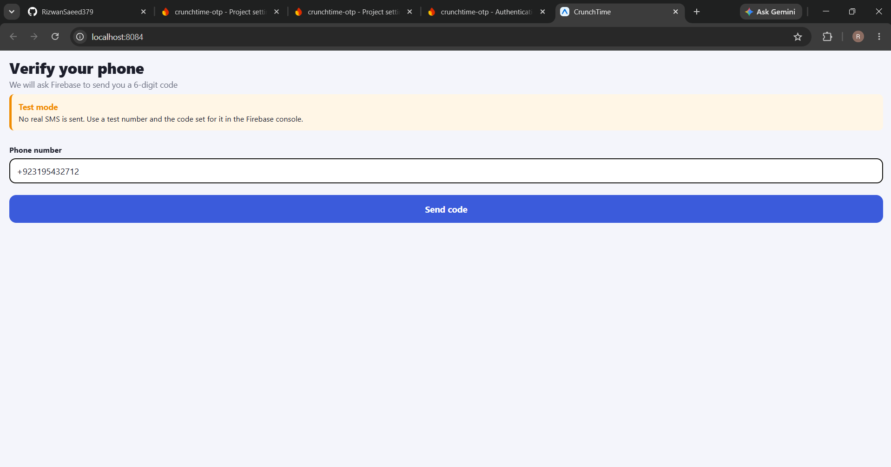
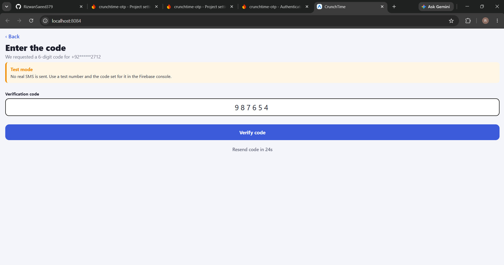
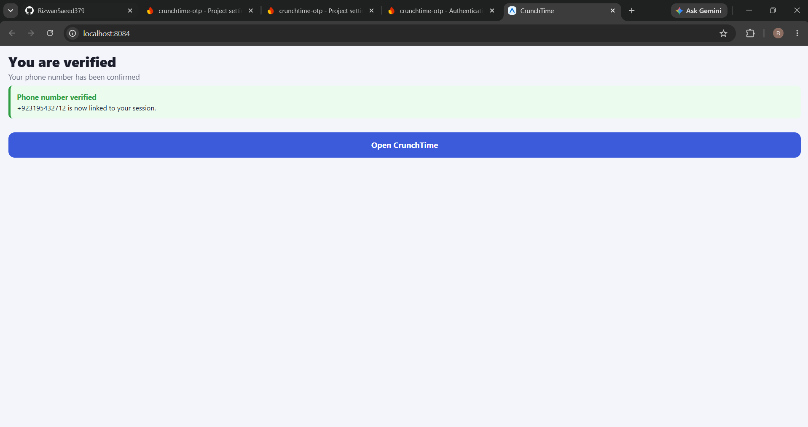
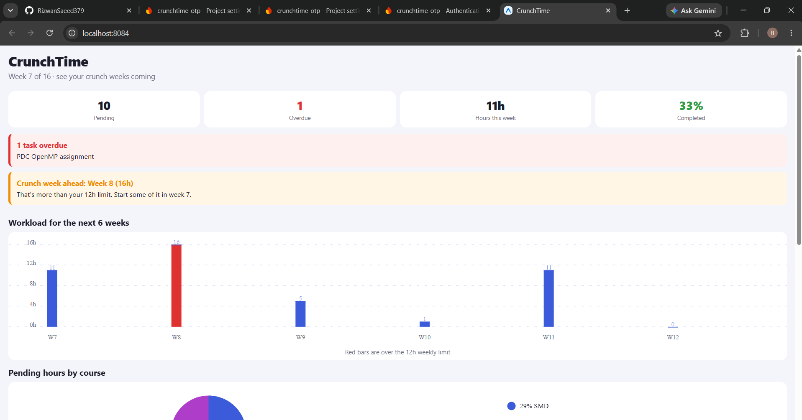
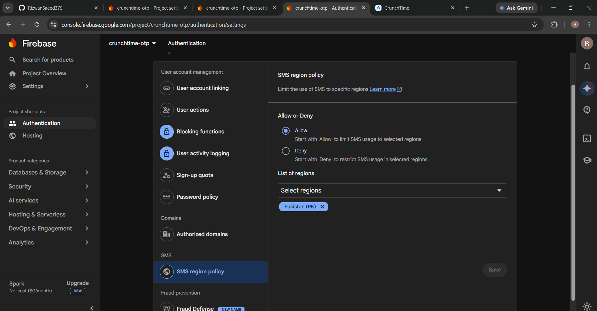
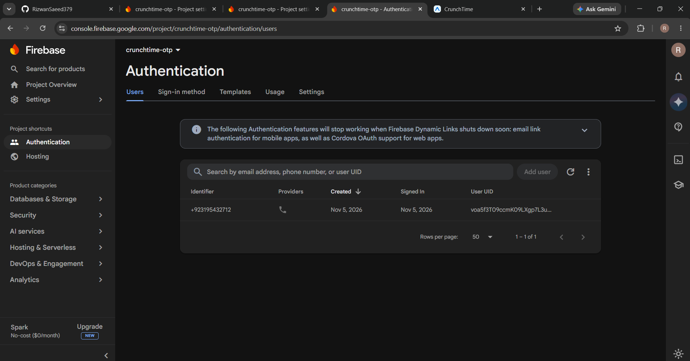
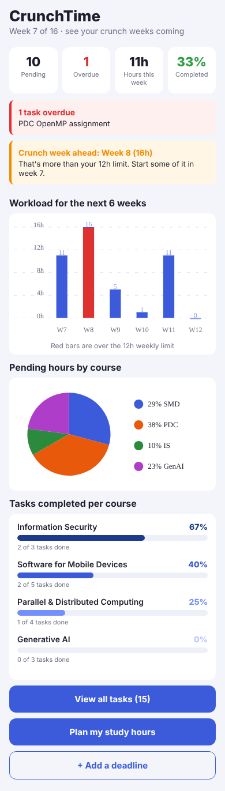
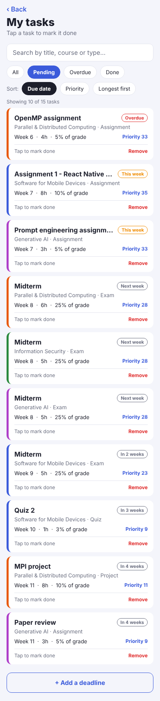
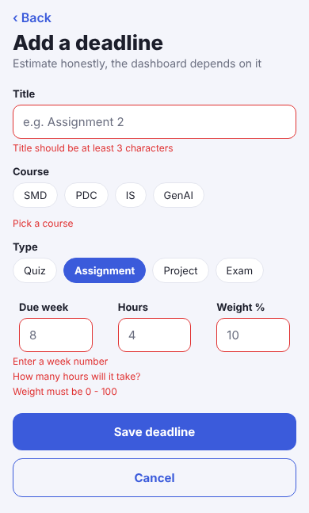
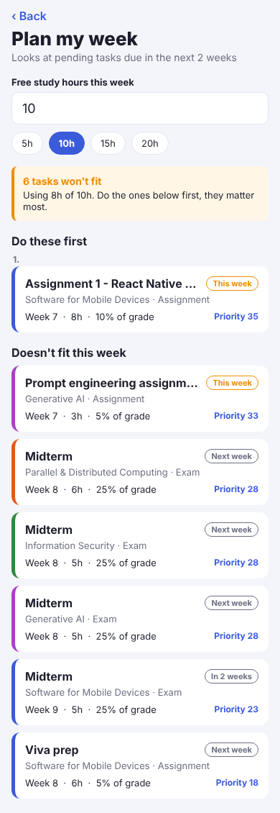

# CrunchTime

> This version adds **phone number OTP verification with Firebase** in front of the app. See [Phone number verification (OTP)](#phone-number-verification-otp).

A React Native (Expo) app that shows students their **crunch weeks** before they arrive.

## The problem

FLEX shows each course on its own. You only find out that two midterms, an assignment and a proposal all land in the same week when that week starts. By then it's too late to spread the work out.

CrunchTime puts all your deadlines from every course in one place. It adds up the hours each week needs, warns you about overloaded weeks in advance, and helps you decide what to do first when you don't have time for everything.

## Features

- **Dashboard** built with `react-native-chart-kit`:
  - Bar chart of pending hours for the next 6 weeks. Weeks over the limit are shown in red.
  - Pie chart of pending hours by course.
  - Completion bar for each course with its percentage, sorted from most to least complete and shaded dark to light.
  - Summary boxes: pending, overdue, hours this week, and % completed.
- **Dynamic warnings**: a banner for overdue tasks, a banner for each crunch week ahead, and a "balanced" message when everything is fine.
- **Task list**:
  - Search by title, course or type.
  - Filter by All, Pending, Overdue or Done.
  - Sort by due date, priority or longest first.
  - Tap a task to mark it done or not done, and remove tasks.
- **Priority score** for each task, based on its grade weight and how close the deadline is.
- **Add deadline form** with validation:
  - Title must be at least 3 characters.
  - A course must be selected.
  - The week must be between the current week and 16.
  - Hours must be 1–40 and weight 0–100.
  - Number fields only accept digits.
- **Week planner**: enter your free hours for the week. It picks the highest-priority tasks due in the next 2 weeks that fit, and lists the ones that don't.
- **Empty and error states**: no matching search results, nothing pending, invalid hours, and nothing due soon.

Screens are switched with a `screen` state variable in `App.js`. There is no navigation library and no tab or side bar.

## Phone number verification (OTP)

Before the app opens, the user has to verify their phone number with a one-time password, using Firebase Authentication.

1. **Type the phone number with its country code** (for example `+92 300 1234567`) in the phone box. The number is checked first: it must start with `+` and look like a valid international number.
2. **Send code.** The app asks Firebase to send a 6-digit code.
3. **Enter the code** in the code box. A wrong, expired or incomplete code shows a red failure message and the user can try again. The code can be sent again after a 30-second countdown, and the user can go back to change the number.
4. **Success.** A green "Phone number verified" message is shown, then the user opens the app.

Files: `firebase.js` (setup from `.env`), `otpService.js` (send code, check code, error messages), `phoneHelpers.js` (number checks) and `screens/VerifyPhoneScreen.js` (the three steps).

### Demo and evidence

**Screen recording of the full flow (send, enter, verify):** [Watch the demo video on Google Drive](https://drive.google.com/file/d/1H76r3KjF-Q6nnJn2ffWsZEw0SzZw-FU5/view?usp=drive_link)

| 1. Enter phone number | 2. Enter OTP | 3. Phone verified |
|---|---|---|
|  |  |  |

| 4. App opens after verification | 5. Firebase SMS region policy | 6. Verified user in Firebase |
|---|---|---|
|  |  |  |

The number used is a Firebase fictional test number, so the code is the one configured for it in the Firebase console and no real SMS was sent (see below).

### Test mode (no real SMS)

The app uses Firebase **fictional test phone numbers**. For these numbers Firebase sends **no real SMS**. The user enters the code that was set for that number in the Firebase console, and the screen shows a "Test mode" notice. `OTP_TEST_MODE` in `constants.js` controls this. Real SMS from the Firebase JavaScript SDK needs a reCAPTCHA check that does not run in Expo Go, so it would need a custom development build.

### Firebase setup

1. Create a project in the [Firebase console](https://console.firebase.google.com) and register a **Web app** to get the config values.
2. **Build > Authentication > Get started**, then **Sign-in method > Phone > Enable**.
3. In the Phone settings, add a number under **Phone numbers for testing** (for example `+1 650-555-3434`, code `123456`) and save.
4. **Authentication > Settings > SMS region policy**: choose Allow and add the country of your test number.
5. Copy `.env.example` to `.env` and fill in the six values. Restart `npx expo start` after changing `.env`.

## Project structure

```
App.js              holds the tasks + current screen state, switches screens
constants.js        current week, crunch-week limit, colours, etc.
data.js             courses and tasks arrays (static data)
helpers.js          calculations: status, priority, weekly hours, filter, sort, planner
firebase.js         Firebase setup from the .env keys
otpService.js       send the OTP, check the OTP, error messages
phoneHelpers.js     phone number cleaning, validation and masking
components/         Header, Chip, StatBox, Banner, EmptyState, TaskCard, AppButton, CourseProgress
screens/            DashboardScreen, TasksScreen, AddTaskScreen, PlannerScreen, VerifyPhoneScreen
```

## How to run

```bash
npm install
npx expo start
```

Then scan the QR code with the Expo Go app on your phone, or press `a` to open the Android emulator or `w` to open it in a browser.

## Things you can change in `constants.js`

| Setting | What it does |
|---|---|
| `CURRENT_WEEK` | Which semester week it is now. Changes overdue/this week/upcoming. |
| `HEAVY_WEEK_HOURS` | Hours above which a week counts as a crunch week (red bar + warning). |
| `WEEKS_TO_SHOW` | How many weeks the bar chart shows. |
| `PLAN_RANGE` | How many weeks ahead the planner looks. |

## Screenshots

| Dashboard | Tasks | Validation | Planner |
|---|---|---|---|
|  |  |  |  |

## AI usage

AI (Claude) was used during development. See the AI Usage Report for details.
